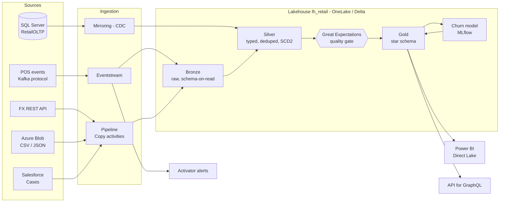

# Real-time Retail Analytics Platform — Microsoft Fabric

End-to-end data engineering project: five heterogeneous sources → medallion lakehouse
(Bronze → Silver with SCD Type 2 → Gold star schema) → data-quality gate → churn ML model →
Power BI, GraphQL API and real-time alerts, orchestrated with Fabric pipelines.



## What's in this repo

| Path | What |
|---|---|
| `docs/BUILD_GUIDE.md` | **Start here.** Phase-by-phase setup with a "done when" check per phase |
| `docs/INTERVIEW_NOTES.md` | Honest resume bullet, concepts to explain, likely interview questions |
| `data_generator/` | Synthetic data with a real churn signal + injected bad data; SQL loader & change simulator; Kafka POS producer; Blob & Salesforce loaders |
| `sql/` | Source DB schema, mirroring login, SQL-endpoint views |
| `notebooks/src/*.py` | Notebook sources (diff-friendly) → `python tools/build_notebooks.py` builds importable `.ipynb` |
| `pipelines/pl_retail_daily.md` | Pipeline spec: activities, retries, dependencies, failure alerting, schedule |
| `powerbi/` | Direct Lake model relationships, report pages, DAX measures |
| `activator/` | Eventstream windowing + Activator rules + demo commands |
| `api/` | API for GraphQL setup + Node.js client |
| `tests/local_e2e.py` | Runs every notebook locally against a fake lakehouse, with assertions |

## Notebooks

| # | Notebook | Layer | Highlights |
|---|---|---|---|
| 00 | `nb_00_common` | – | config, SCD1 upsert, **SCD2 merge**, watermarks, run log, quarantine |
| 01 | `nb_01_bronze_ingest` | Bronze | incremental file ingestion with `availableNow` streams + checkpoints |
| 02 | `nb_02_silver_dimensions` | Silver | SCD2 customers & products (incl. deletes), SCD1 stores |
| 03 | `nb_03_silver_facts` | Silver | watermark loads, exactly-once streaming MERGE, FX gap-fill, JSON flattening, quarantine |
| 04 | `nb_04_data_quality` | Gate | 26 Great Expectations checks, critical failures stop the pipeline |
| 05 | `nb_05_gold_star_schema` | Gold | surrogate keys, unknown members, point-in-time joins, multi-currency → INR |
| 06 | `nb_06_churn_features` | ML | leakage-safe point-in-time features, shared by train & score |
| 07 | `nb_07_churn_train` | ML | out-of-time validation, 2 models compared in MLflow, model registry |
| 08 | `nb_08_churn_score` | ML | batch scoring into `gold_churn_scores` with daily snapshots |

## Quick start (local, no Fabric needed)
```bash
cd data_generator
pip install -r requirements.txt
python generate_data.py
cd ..
pip install "pyspark==3.5.*" "delta-spark==3.2.*" "great_expectations>=1.3,<2" mlflow scikit-learn pandas
python tests/local_e2e.py            # needs Java 17+; downloads Delta jars from Maven on first run
# no internet access to Maven? USE_DELTA_SHIM=1 python tests/local_e2e.py
```
The test checks: SCD2 versions/deletes/no-op runs, idempotent re-runs, no orphaned facts,
point-in-time attribution, FX coverage, the DQ gate blocking duplicates, and end-to-end ML scoring.

Then follow `docs/BUILD_GUIDE.md` to build it in Fabric.

## Changes from the original design (and why)
* **SQL Server → Mirroring** (not Data Factory) and **Blob → Copy activity** (not Mirroring):
  Mirroring is the CDC path for databases; files are copied.
* **Kafka** is represented by a Kafka-protocol producer sending to Eventstream's Kafka endpoint, not
  a self-hosted Kafka cluster.
* **Copilot insights** dropped: not available on Fabric trial capacity.
* **REST API layer** = Fabric API for GraphQL (no server to host) + a Node.js client.
* **Great Expectations** runs as a blocking gate between Silver and Gold, not just a report.

## Screenshots
_Add yours here: mirroring status · Eventstream canvas · SCD2 history · DQ failure + alert email ·
MLflow run comparison · pipeline run · Power BI pages · Activator alert._
